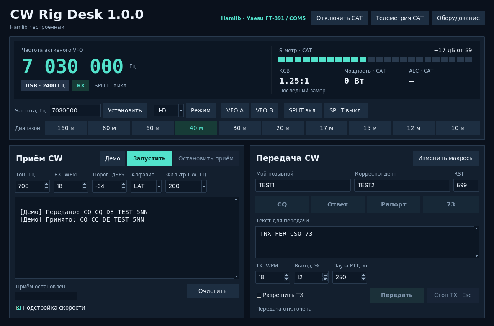

# CW Rig Desk

[Русский](README.ru.md) · English · [Download for Windows x64](https://github.com/wildwolfgolf/cw-rig-desk/releases/latest) · [Illustrated user guide (PDF, Russian)](docs/CW_Rig_Desk_User_Guide_RU.pdf)

Windows desktop workstation for receiving, decoding and transmitting Morse code. A radio profile controls the rig, while Windows audio devices carry the received signal and transmit tones. The app includes Russian and Latin decoding, CW filters, HF presets, telemetry and editable macros. It is the desktop successor to G90 CW.

| Connection | Typical equipment | How audio is routed |
| --- | --- | --- |
| Direct Xiegu G90 CI-V | G90/G90S with DE-19 | DE-19 USB audio and ACC |
| Built-in Hamlib | Yaesu FT-891, Icom IC-7300, Kenwood TS-590SG and other [Hamlib backends](https://github.com/Hamlib/Hamlib/wiki/Supported-Radios) | Rig USB audio or a separate audio interface |
| TCI over WebSocket | ExpertSDR3 with a SunSDR radio and compatible TCI servers | Windows sound device or virtual audio routing. TCI is used for control and telemetry. |

Frequency, mode, bands, VFO/channel, split and PTT follow the selected profile. Meter readings and optional commands depend on the device, server and firmware. Models listed under Hamlib are examples from Hamlib's supported-rig list. Hardware operation has yet to be verified for this release.



## Quick start

1. Download the `CW_Rig_Desk-*-windows-x64.exe` asset from the [latest release](https://github.com/wildwolfgolf/cw-rig-desk/releases/latest) and double-click it. The executable includes Python and Hamlib and runs without installation.
2. Open **Оборудование** (Equipment). Select **Вход RX** (RX input), **Выход TX** (TX output) and **Интерфейс CAT** (CAT interface).
3. Use **Подключить CAT** (Connect CAT), or **Подключить** (Connect) in the built-in Hamlib dialog. Turn the tuning knob and verify that the frequency follows. Select a CW tone and click **Запустить** (Start). **Демо** runs the decoder on a generated signal with no hardware.
4. To send, select the radio's upper-sideband audio/data mode and route the selected playback device to the radio input. Start at low power into a suitable dummy load. Enable **Разрешить TX**, then click **Передать** (Send) or a macro. **Esc** stops the transmission. The app sends keyed audio tones under PTT in USB or upper-sideband data mode. The same transmit path is used for typed text and macros.

## Connect a radio

### Built-in Hamlib

1. Connect your radio's USB CAT cable and turn the radio on.
2. Open **Оборудование** (Equipment), select **Hamlib · встроенный** (built-in), and choose your radio under **Модель** (Model). You can type part of its name to narrow the list.
3. Click **Подключить** (Connect). CW Rig Desk starts and stops Hamlib automatically.

Leave **Порт CAT** (CAT port) and **Скорость CAT** (CAT speed) on **Авто** (Auto). The app can select a single USB serial port automatically or, for the FT-891, a uniquely identified Silicon Labs Enhanced port. If the app cannot identify the port, use the CAT port shown in Windows Device Manager. If the radio uses a different CAT speed from the Hamlib default, select the speed from the radio's menu. Release the port if another program has it open.

Select the RX and TX audio devices separately. For example, an FT-891 typically uses an audio interface connected to its DATA port.

The Windows x64 executable includes Hamlib 4.7.2. Its corresponding source is available with each release. If you run from a Git checkout, CW Rig Desk fetches and verifies the official runtime the first time you select the built-in profile. To connect to an existing Hamlib server, choose **Hamlib · rigctld** and enter its host and port.

### TCI

Start the SDR and enable TCI in ExpertSDR3. Use the endpoint shown in its settings, for example `ws://127.0.0.1:40001`. Select **TCI · WebSocket** and receiver **0** (first) or **1** (second). CW Rig Desk reads the server's state and follows its updates. VFO A/B selects the channel managed by this app for the chosen receiver.

Route the SDR's receive audio to **Вход RX** using a sound device or a virtual audio cable. For TX, route the app's selected **Выход TX** to **Mic PC** in ExpertSDR. The app requests that source explicitly over TCI. Select USB or DIGU and channel A with SPLIT off. This desktop release uses Windows sound devices for audio. TCI binary audio streams and the native TCI CW keyer are separate features that are outside this implementation.

### Direct G90

Choose **Xiegu G90 · CI-V**. Connect DE-19 ACC to the G90 rear ACC port and DE-19 CIV to the COMM port on the G90 display head. Choose its COM port and CI-V address **70** or **88**. Use DE-19 audio devices and U-D on the G90. The program can import existing G90 CW settings on first start.

## Development

Python 3.12 or 3.13 with Tcl/Tk is used for a source checkout. On Windows, run `start_windows.bat` or install `requirements.txt` and run `python -m cw_rig_desk`.

```sh
python -m pip install -r requirements.txt -r requirements-test.txt
python -m unittest discover -s tests -v
```

The automated tests use local TCP and WebSocket simulators and synthetic CW audio. GitHub Actions runs them on Windows with Python 3.12 and 3.13 and launches the standalone EXE to verify Tk, PortAudio, CW decoding and the embedded Hamlib Dummy driver.

For a release, update `__version__` in `cw_rig_desk/__init__.py` using MAJOR.MINOR.PATCH and add the matching section in [CHANGELOG.md](CHANGELOG.md). On `main`, the workflow publishes a new GitHub Release and tag after the tests pass. Existing release assets are preserved. To build locally on Windows x64 with Python 3.13, install `requirements-build.txt` and run `python -m tools.package_windows`.

References for the connection design: [WSJT-X setup guide](https://wsjt.sourceforge.io/wsjtx-main_en.html) · [FT8CN](https://github.com/N0BOY/FT8CN) · [Hamlib rigctld protocol](https://manpages.debian.org/trixie/libhamlib-utils/rigctld.1.en.html) · [ExpertSDR TCI specification](https://github.com/ExpertSDR3/TCI).
