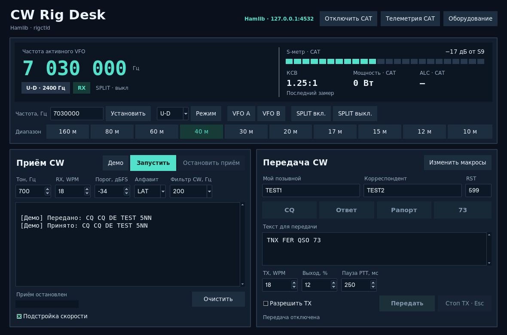

# CW Rig Desk

Русский · [English](README.md) · [Руководство со скриншотами (PDF)](docs/CW_Rig_Desk_User_Guide_RU.pdf)

Программа для Windows для приёма, декодирования и передачи Морзе. Поддерживает латиницу и кириллицу, полосовые фильтры CW, кнопки КВ-диапазонов и редактируемые макросы. Это продолжение настольного проекта G90 CW.

| Интерфейс | Примеры оборудования | Звук |
| --- | --- | --- |
| Прямой CI-V | Xiegu G90/G90S с DE-19 | USB-аудио DE-19 и ACC |
| Hamlib rigctld | Yaesu FT-891, Icom IC-7300, Kenwood TS-590SG и другие модели из [списка Hamlib](https://github.com/Hamlib/Hamlib/wiki/Supported-Radios) | USB-аудио трансивера или отдельный аудиоинтерфейс |
| TCI по WebSocket | ExpertSDR3 с SunSDR и совместимые серверы TCI | Звуковые устройства Windows или виртуальные аудиокабели |

Доступность команд VFO, SPLIT, PTT и показаний зависит от сервера, модели и прошивки. Примеры в строке Hamlib взяты из списка драйверов Hamlib. Проверка с физическими трансиверами для этой версии ещё предстоит.



## Первый запуск

1. Установите Python 3.12 или 3.13 для Windows с Tcl/Tk. Распакуйте архив или клонируйте проект. Запустите `start_windows.bat`. При первом запуске программа создаст локальное окружение и установит зависимости.
2. Откройте **Оборудование**, выберите **Вход RX**, **Выход TX** и **Интерфейс CAT**. Заполните поля выбранного интерфейса и нажмите **Готово → Подключить CAT**. Поверните ручку трансивера и проверьте частоту в программе.
3. Для приёма выберите тон (например, 700 Гц), начальную скорость (например, 18 WPM), алфавит LAT или RUS и подходящий CW-фильтр. Нажмите **Запустить**. **Демо** проверяет декодер на тестовом сигнале без трансивера.
4. Для передачи настройте USB или режим данных на верхней боковой полосе и направьте звук от ПК на вход трансивера. Первую пробу выполните на малой мощности с подходящим эквивалентом нагрузки. Отметьте **Разрешить TX**, затем нажмите **Передать** или кнопку макроса. **Esc** прерывает передачу. Программа формирует манипулированный аудиотон и управляет PTT.

## Hamlib · rigctld

Установите [Hamlib для Windows](https://github.com/Hamlib/Hamlib/releases) отдельно. Командой `rigctl.exe -l` найдите номер модели. Укажите COM-порт CAT и скорость из меню радиостанции. Например, для FT-891 при совпадающих порте и скорости:

```powershell
rigctld.exe -m 1036 -r COM5 -s 38400 -P RIG -T 127.0.0.1 -t 4532
```

Примеры номеров: Yaesu FT-891 — **1036**, Icom IC-7300 — **3073**, Kenwood TS-590SG — **2037**. Сверьте с установленным Hamlib. Закройте программы, напрямую занявшие COM-порт. Запускайте rigctld без `-o`. В программе выберите **Hamlib · rigctld**, хост `127.0.0.1` и порт `4532`. Аудиотракт настраивается отдельно. У FT-891 звук обычно проходит через отдельный интерфейс, подключённый к разъёму DATA.

## TCI · WebSocket

Запустите приёмник и включите TCI в ExpertSDR3. В CW Rig Desk выберите **TCI · WebSocket**, введите адрес сервера (например, `ws://127.0.0.1:40001`) и номер приёмника **0** (первый) или **1** (второй). Кнопки VFO A/B выбирают управляемый канал внутри выбранного приёмника. Программа получает текущие частоту и режим и отслеживает дальнейшие изменения от сервера.

Направьте звук приёмника SDR на **Вход RX** программы через звуковое устройство или виртуальный аудиокабель. Для TX направьте **Выход TX** в источник **Mic PC** в ExpertSDR. CW Rig Desk явно запрашивает его по TCI. Для передачи выберите USB или DIGU, канал A, SPLIT выключен. Звук в этой версии проходит через устройства Windows. Бинарное аудио TCI и встроенный ключер TCI в эту реализацию не входят.

## Прямое подключение Xiegu G90

Для профиля **Xiegu G90 · CI-V** соедините ACC DE-19 с задним ACC G90, а CIV DE-19 с COMM на головке G90. Выберите COM-порт, адрес CI-V **70** или **88** и аудиоустройства DE-19. На G90 используйте режим U-D. При первом запуске можно продолжить со своими настройками G90 CW: программа читает прежний файл, если нового ещё нет.

## Как устроено подключение

- Из [WSJT-X](https://wsjt.sourceforge.io/wsjtx-main_en.html) взят подход с раздельной настройкой CAT и звука и подключением к общему сервису rigctld.
- В [FT8CN](https://github.com/N0BOY/FT8CN/releases) использованы отдельные настройки моделей и режима USB DATA, в частности у FT-891 и FT-991. В CW Rig Desk модельно-зависимые команды вынесены в Hamlib. G90 сохранил прямой профиль.
- Для TCI использована [спецификация Expert Electronics](https://github.com/ExpertSDR3/TCI). Клиент принимает синхронизацию состояния и события сервера через WebSocket. Клиенты протоколов написаны для CW Rig Desk.

## Проверки перед публикацией

```sh
python -m pip install -r requirements.txt -r requirements-test.txt
python -m unittest discover -s tests -v
```

В проекте есть CI для Windows/Python 3.12 и 3.13 и стендовые тесты TCP, WebSocket и декодирования. Для нового репозитория подойдёт имя `cw-rig-desk`. Выбор лицензии остаётся за владельцем проекта.
